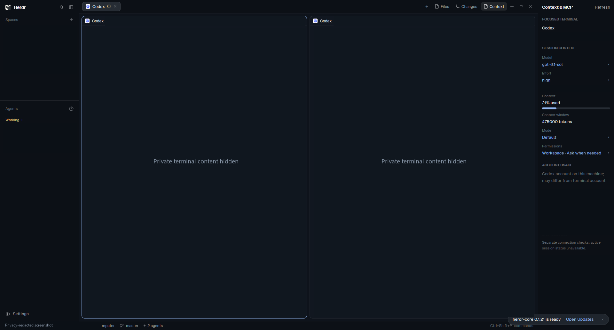

# Herdr Sidebar

A desktop layout for [Herdr App](https://github.com/herdrdev/herdr-app) that puts
spaces and agents on the left, Files and Git Changes alongside the terminal,
and session context on the right. The Context panel supports Codex and can show
Claude Code session details through the [optional bridge](#claude-code-bridge-optional).



## Install

You'll need Herdr App running, `herdr-app` on PATH, and Python 3.12+ for the
[installer](install.py). The installer and mod checks were tested on Windows
with Herdr App 0.1.18. macOS and Linux app behavior remains unverified.

The mods can run local programs and read project and assistant session data.
The Files panel can write local edits, and MCP checks can start configured
servers. Review the [runtime access details](RECIPE.md#watch-out) before installing.

### 1. Clone and preview

```sh
git clone https://github.com/namsejo56/herdr-sidebar.git
cd herdr-sidebar
```

Run the remaining commands from the checkout root.

The installer defaults to `HERDR_APP_HOME` when set, or to
`~/.config/herdr-app` (`%USERPROFILE%\.config\herdr-app` on Windows). For a
custom home, launch Herdr App and run the commands below with `HERDR_APP_HOME`
pointing to the same directory. The installer's `--app-home PATH` option
overrides the destination. If you use that option, pass the same path to the
dry run and the install.

Save the `layout` reported by `herdr-app status`. Keep the dry-run output so
you can identify the files this installation is expected to add.

```powershell
herdr-app status
python install.py --dry-run
```

On macOS or Linux, use `python3` in the installer commands.

The installer skips identical files and stops before copying if a destination
conflicts. If you resolve a conflict or change the destination, rerun the
preview before installing.

### 2. Install and validate

```powershell
python install.py
```

From the checkout root, check each installed mod before switching layouts.
If you passed `--app-home`, use that same path for `$appHome` or `appHome` below.

**PowerShell**

```powershell
$appHome = Join-Path $HOME '.config/herdr-app'
if ($env:HERDR_APP_HOME) { $appHome = $env:HERDR_APP_HOME }

foreach ($mod in Get-ChildItem -LiteralPath ./mods -Directory) {
    herdr-app check (Join-Path $appHome "mods/$($mod.Name)") | Out-Host
    if ($LASTEXITCODE -ne 0) { throw "Mod check failed: $($mod.Name)" }
}
```

**POSIX shell**

```sh
appHome="${HERDR_APP_HOME:-$HOME/.config/herdr-app}"
(
  set -e
  for mod in mods/*/; do
    herdr-app check "$appHome/$mod"
  done
)
```

### 3. Activate and smoke-test

Once all checks pass, run:

```sh
herdr-app do layout.switch --name native-agent-view
herdr-app status
```

Confirm the status shows `native-agent-view` and an empty `errors` list. In the
window, open Files, Changes and Context from the tab bar.

## Claude Code bridge (optional)

Install the bridge on each machine where Claude Code runs to show its session
model, effort, context usage and limits in the sidebar. From the checkout root:

```sh
claude plugin marketplace add ./
claude plugin install herdr-bridge@herdr-sidebar
```

Keep only one enabled `herdr-bridge` installation. If it is already enabled
from another marketplace, disable or remove that copy first so duplicate hooks
do not publish competing snapshots or process the same request twice.
Use `/reload-plugins` when supported, or restart Claude. Inside a Herdr terminal,
the bridge writes a snapshot to `~/.claude/herdr-bridge/<terminal>.json`.

## Roll back

Replace `PREVIOUS_LAYOUT` with the layout name recorded in step 1.

```sh
herdr-app do layout.switch --name "PREVIOUS_LAYOUT"
herdr-app status
```

After confirming the previous layout is active, use the saved preview to
identify the files added by this installation. Remove only those additions
once the sidebar's panes are closed. If you installed the Claude bridge from
this repo, remove it with
`claude plugin uninstall herdr-bridge@herdr-sidebar`. Re-enable your previous
bridge if you disabled it for this installation.

## Feature requirements and limits

- **Files and Changes.** Git enables diffs and status markers. Files auto-saves
  local edits and preserves drafts if the file changes externally. The
  Markdown Content view renders text without Mermaid. Node enables the optional
  fast file reader.
- **Codex.** Requires the Codex CLI on the terminal's machine. MCP discovery
  uses Node and separate checks that may start servers. Account usage comes
  from a separate app-server and may show a different account. Changing session
  settings requires an identified thread already loaded in a compatible Codex
  daemon. Remote and provider-specific behavior needs separate validation.
- **Claude Code.** The bridge applies model and effort changes once Claude is
  idle. Claude saves those choices as defaults for new sessions. Permission mode
  can show as unavailable if another plugin intercepts classic hooks. The
  sidebar currently has no Claude tool inventory. Agent process discovery uses
  PowerShell.

See the [recipe](RECIPE.md) for layout and mod details, including native agent
navigation and optional overlays.

## Development checks

Run from this repository root with Node 24+ and Python 3.12+:

```sh
node --test --test-concurrency=1 tests/*.test.cjs
python tests/session-context.test.py
python tests/session-controls.test.py
claude plugin validate .
claude plugin validate claude-mods/herdr-bridge
claude plugin test claude-mods/herdr-bridge
```

These test source behavior with isolated fixtures. They do not prove live UI,
remote-machine behavior or provider compatibility. Also run Herdr's mod checks
and exercise the actual panels. The optional Windows integration check
`python tests/codex-mcp-details-integration.py` requires Node and Codex on PATH
and starts isolated local MCP test servers.

## Share

Follow [Herdr's sharing guide](https://github.com/herdrdev/herdr-app/blob/master/defaults/AGENTS.md#layouts-and-mods-other-people-made)
to publish this package as a layout with the **`herdr-layout`** repository topic.

## License

Herdr Sidebar is distributed under the [Apache License 2.0](LICENSE).
Attribution for the adapted Herdr App components is in [NOTICE](NOTICE).
