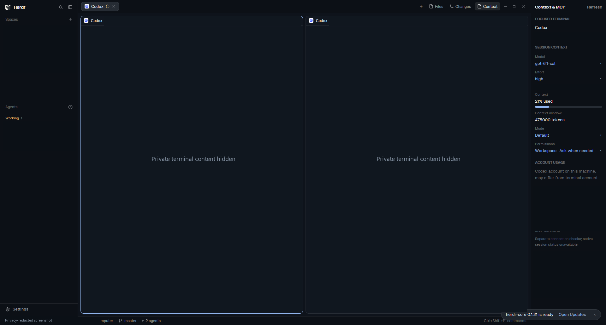

# Herdr Sidebar recipe

Build a native Herdr window for working with multiple agent terminals, with
navigation on the left and focused-terminal context on the right. The files
in this repository are one implementation of this recipe.

## What you see

Use [layouts/native-agent-view.json](layouts/native-agent-view.json) as the
layout entry point. Use theme colors throughout and keep terminal rendering
native. The left sidebar contains the built-in workspace chrome, spaces,
custom native agents list and footer. The top bar contains tabs plus Files,
Changes and Context toggles. Keep the status bar below the work area.

The center holds active tab panes. Files and Changes share a panel area next to
the work area, and focused-terminal context occupies the right-hand block.

The layout file is the source of truth for its exact sizes, node tree and
theme values; this recipe describes the intended composition rather than
duplicating those values.

## How it behaves

The left navigation groups agents and subagents, focuses existing terminals,
opens existing child terminals with peek, and asks before creating an
interactive fork when no matching live terminal exists. The top bar preserves
native tab and window controls and toggles Files, Changes and Context.

Files can browse and search by space, machine and root, open Raw or Content
views, cache and refresh metadata, watch folder changes, and auto-save local
edits. External changes pause saving and preserve the draft. Changes can show a
flat list or collapsible tree and open diffs while retaining the existing Git
action confirmations. Closing a single file pane returns to its originating
tab.

Context shows focused-terminal identity, MCP inventory, separate connection
checks, tool details and Codex quota. Its sections collapse independently and
the session ID can be copied. Codex settings catalogs can be browsed before a
session is identified, while writes stay scoped to the exact verified session;
the terminal context gauge is preferred with a validated log fallback.

The package also contains optional transcript and alternative-navigation
experiences; the default layout does not open either one.

## Built from

The implementation is assembled from the layout entry point and the mod
folders named in its `content.mod` references. Optional compatibility and
alternative modules remain in the package but are not mounted by the default
layout. The included [README.md](README.md) is the operational entry point for
the non-destructive installer and the separate `herdr-bridge` Claude Code
plugin.

The main implementation modules are `native-agents`, `context-tabs-261109`,
`claude-files-261106`, `claude-editor-pane`, `changes-tree-261110` and
`context-inspector-261109`. `mcp-details-261109` forwards older overlay calls;
`claude-transcript` and `claude-navigation-261106` are optional. The layout
mounts the editor pane through `content.pane.header`, uses a hidden Files and
Changes stack plus a zero-width Files service block with
`catalogService: true`, and puts the Context inspector in the right-hand block.

## Watch out

The original export targeted the installed Herdr App 0.1.15 API. The packaged
layout and mod files were compared byte-for-byte with the corresponding files
installed on Herdr App 0.1.18; this does not claim a clean-install live result.
Read the target installation's generated `AGENTS.md`, `herdr.d.ts` and
`gpui-kit.d.ts` before adapting the recipe. Do not copy editor-generated types
or personal configuration into this package.

The mods execute Git, Node, Python, PowerShell or shell utilities, `hc`, Claude
and Codex as needed. They read project files, Git status, MCP/Codex configuration,
session indexes, session metadata and activity records. They watch project
folders. Files can write local project files and keep drafts in Herdr mod state;
Changes can run its existing user-invoked Git actions. Agent actions can launch
or fork terminals, and session controls can change a loaded Codex thread's settings.

MCP checks can start configured servers and those servers may reach the network.
Codex account checks use a separate app-server. No accounts, credentials,
terminal transcripts or MCP configurations ship with this package. Do not print
configuration secrets in the UI. The metadata filter is heuristic and is not
a guarantee that every server-provided secret will be recognized.

## Done when

Follow [README.md](README.md#install), preserving existing files. The
installer must complete without a conflict, then every copied mod must pass
`herdr-app check`. A check may create generated editor metadata in the app
home; keep those files out of the package and remove only the generated files
when cleaning up validation output.

Select the copied layout with
`herdr-app do layout.switch --name native-agent-view`, inspect
`herdr-app status`, and exercise the actual panels. Verify empty, loading and
error states, unavailable CLIs, and the screenshot; keep the previous layout
available so `ctrl-shift-l` or a layout switch can roll back. A mod check
renders only once and does not prove asynchronous behavior or every
pane/overlay state.

Windows is the observed export environment. Claude process discovery uses
PowerShell; remote sessions, other operating systems and live provider/control
compatibility require separate verification. See README for the current limits.
